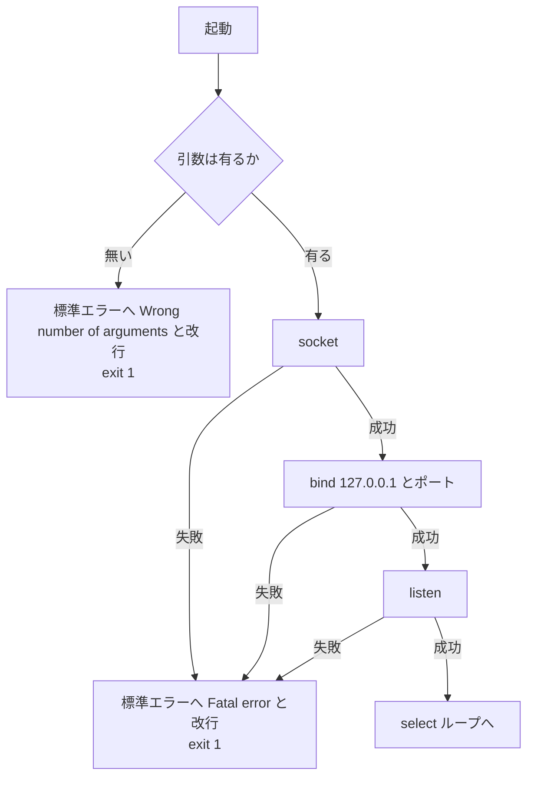
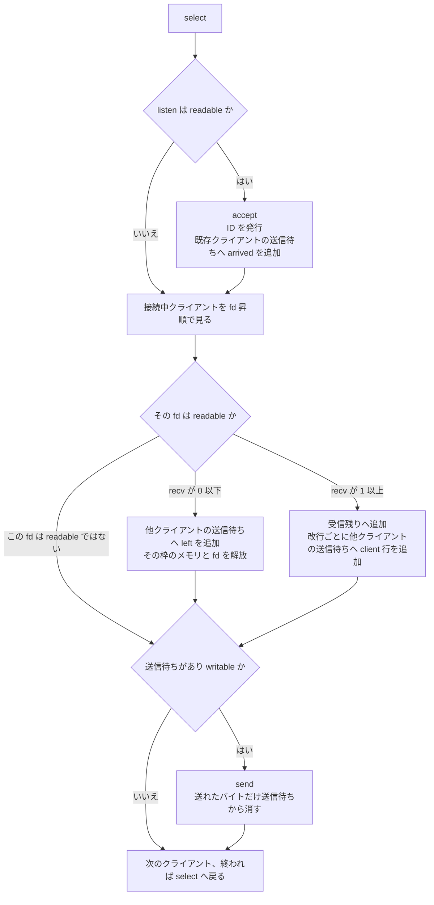
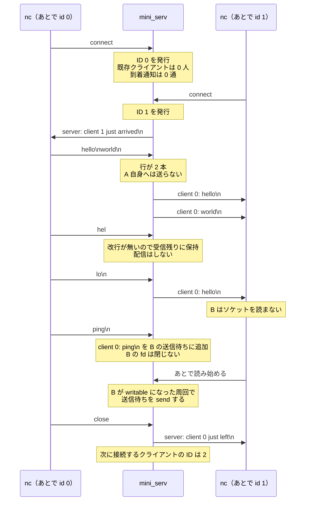

# mini_serv データフロー

> 作成日: 2026-10-12
> 根拠: [mini_serv.txt](mini_serv.txt) の和訳 [mini_serv_ja.md](mini_serv_ja.md)
> 対照: [bircd データフロー図](../bircd_data_flow_diagram.md)
> これは完成コードではない。課題が要求するバイトの流れである。

bircd と同じく、アプリケーション層のコマンドは無い。`nc` が送ったバイト列を、行に切って他のクライアントへ渡す TCP のリレーである。

bircd から持っていくものは、`fd_set`、fd を添字にしたクライアント表、`select` の無限ループである。関数ポインタ、`#define`、固定長の送受信配列、libft、`poll`、`\r\n` 切り出しは持っていかない。

---

## 1. サーバーが持つもの

| 名前 | 内容 |
|------|------|
| listen fd | `127.0.0.1` の、引数で指定したポートで `listen` しているソケット |
| 次に発行する ID | 初期値 0。accept のたびに、今の値を渡し、そのあと 1 増やす |
| クライアント表 | fd ごとに 1 枠。空いている枠と、接続中の枠を区別する |

接続中の 1 枠:

| 欄 | 内容 |
|----|------|
| fd | `accept` が返した fd |
| id | 発行済み ID。fd とは別の数 |
| 受信残り | まだ `\n` が届いていないバイト |
| 送信待ち | まだ `send` しきれていないバイト |

`select` に渡す集合:

| 集合 | 入れる fd |
|------|-----------|
| 読み | listen fd と、接続中の全クライアント |
| 書き | 送信待ちが空でないクライアント |

`select` の第 1 引数は、監視している fd の最大値 + 1。

---

## 2. 起動（段階 1、段階 2）

失敗した時点で、確保済みのメモリと開いた fd を解放してから `exit` する。リークは禁止されている。

メモリ確保に失敗したときも、同じ `Fatal error` で終了する。これはループに入ったあとでも同じである。

---

## 3. ループ 1 周（最終形）

課題文は、同時に複数の fd が準備できたときの処理順を指定していない。この図では次の順に固定する。実装もこの順にする。

1. `select` で待つ。
2. listen fd が readable なら `accept` する。この周回で増えたクライアントは、今回の `select` の集合に入っていない。その fd の `recv` は、次の `select` で readable になってから行う。
3. 接続中のクライアントを fd の昇順に見て、readable なら `recv` する。
4. 送信待ちがあり、かつ writable なクライアントへ `send` する。

`accept`、`recv`、`send` は、今回の `select` がその fd を readable または writable と示した場合にだけ呼ぶ。

---

## 4. メッセージが分かれる場所

自分の送信待ちには追加しない。

1 回の `recv` に行が複数あれば、その回数だけ取り出す。最後に `\n` の無い末尾は、受信残りに置いたまま次の `recv` を待つ。

---

## 5. シナリオ

登場人物は 2 つの `nc` である。サーバーが発行する ID は、接続順に 0、次は 1。

上の矢印のうち、サーバーから `nc` への矢印は「そのクライアントの送信待ちに入り、writable の周回で `send` される」という意味である。`recv` した関数の中で、write 集合を見ずに `send` する、という意味ではない。

---

## 6. バイト列の対応

| 出来事 | 受信残り | 相手の送信待ちに追加するバイト |
|--------|----------|--------------------------------|
| ID 1 が接続。既存は ID 0 だけ | 変化なし | ID 0 へ `server: client 1 just arrived\n` |
| ID 0 から `hello\nworld\n` | 空のまま | ID 1 へ `client 0: hello\n` と `client 0: world\n` |
| ID 0 から `hel` | ID 0 の受信残りは `hel` | 追加なし |
| ID 0 から `lo\n` | 受信残りは空に戻る | ID 1 へ `client 0: hello\n` |
| ID 0 が切断。残っているのは ID 1 | ID 0 の枠を解放 | ID 1 へ `server: client 0 just left\n` |

`\n` が無いまま ID 0 が切断されたとき、受信残りを配信するかは課題文に無い。その段階に入るときに決める。

---

## 7. 段階との対応

最終形は上の図である。試験中は下の順で、動く範囲を広げる。

| 段階 | この図のどこか | 手元の `nc` で確認すること |
|------|----------------|----------------------------|
| 1 | 図 2 の引数エラーと `Fatal error` | 引数なしで標準エラーと終了ステータス 1 |
| 2 | 図 2 の `socket` / `bind` / `listen` | `nc 127.0.0.1 ポート` で接続できる。データはまだ流れない |
| 3 | 図 3 の `accept` と到着通知 | 2 本目の `nc` が繋がったとき、1 本目に arrived が出る |
| 4 | 図 3 の `recv` が 0 以下 | 1 本切ると、残った方に left が出る。fd を閉じる |
| 5 | 図 4 の、最初から `\n` で終わっている行 | `hello\nworld\n` が 2 行になって相手に出る。送信者には出ない |
| 6 | 図 4 の受信残り | `hel` と `lo\n` を分けて送っても、相手には 1 行で出る |
| 7 | 図 3 の `send` と送信待ち | 読まない `nc` を切らない。読ませたあとに、溜めた行が届く |

段階 3 から 6 までは、手元の `nc` がすぐに読むので、送信待ちを後回しにしても動いて見える。試験で渡される fd は、`select` が writable と示す前の `send` がブロックする。到着通知も会話も切断通知も、最終的には送信待ちを通り、writable の周回で `send` する。
