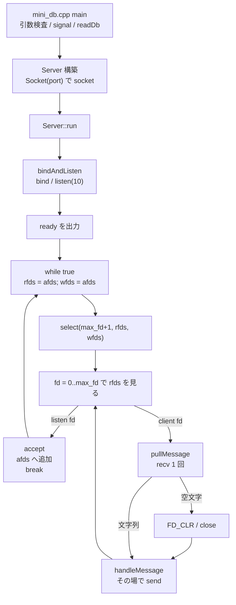

# mini_db.hpp 分析（mini_serv の練習材料として）

> 作成日: 2026-10-12
> 対象: [terminal-42s/42_examshell `.resources/rank06/mini_db/mini_db.hpp`](https://github.com/terminal-42s/42_examshell/blob/main/.resources/rank06/mini_db/mini_db.hpp)
> 同時に読んだもの（同リポジトリ `.resources/rank06/`）:
> - [mini_db/sub.txt](https://github.com/terminal-42s/42_examshell/blob/main/.resources/rank06/mini_db/sub.txt)
> - [mini_db/mini_db.cpp](https://github.com/terminal-42s/42_examshell/blob/main/.resources/rank06/mini_db/mini_db.cpp)
> - [mini_db/tester.sh](https://github.com/terminal-42s/42_examshell/blob/main/.resources/rank06/mini_db/tester.sh)
> - [mini_serv/sub.txt](https://github.com/terminal-42s/42_examshell/blob/main/.resources/rank06/mini_serv/sub.txt)
> - [mini_serv/mini_serv.c](https://github.com/terminal-42s/42_examshell/blob/main/.resources/rank06/mini_serv/mini_serv.c)
> - [mini_serv/tester.sh](https://github.com/terminal-42s/42_examshell/blob/main/.resources/rank06/mini_serv/tester.sh)
>
> 照合先: [mini_serv 課題文 和訳](../mini_serv_ja.md)、[mini_serv データフロー](../mini_serv_data_flow.md)、[bircd 分析](../../bircd_analysis.md)
>
> ソースの写しはこのリポジトリに置かない。必要な行だけ引用する。

---

## 1. 結論

`mini_db.hpp` は **mini_serv の回答例ではない**。rank06 の別課題 `mini_db`（C++ のキー・バリューストア）の回答例である。

mini_serv に持っていけるのは、`select` ループの骨格だけである。具体的には、マスター集合 `afds` を毎周 `rfds` へ複写すること、`max_fd` を追うこと、`0..max_fd` を `FD_ISSET` で走査すること、listen fd とクライアント fd を分けること、`recv` が 0 以下なら `FD_CLR` して `close` すること、の 5 点である。

次の点は mini_serv の要求に反するので、持っていかない。

- 待ち受けアドレスが `INADDR_ANY`
- 書き集合を作るが使わず、`select` の直後に、書けるかを確かめずに `send` する
- クライアントごとの受信残りと送信待ちが無い
- `close` した fd に、そのあと `send` する
- 起動失敗でも終了ステータスが 0 になる経路がある

同じディレクトリのテスター 2 本は、どちらも失敗しても最後に `PASSED` を出して `exit 0` する。動作の正しさの根拠にはならない。

---

## 2. mini_db の課題（比較のための要約）

[mini_db/sub.txt](https://github.com/terminal-42s/42_examshell/blob/main/.resources/rank06/mini_db/sub.txt) の要点:

| 項目 | mini_db | mini_serv |
|------|---------|-----------|
| 言語・提出 | C++。`*.cpp` と `*.hpp` | C。`mini_serv.c` |
| 引数 | ポートと保存先パス | ポート |
| 待ち受け | 127.0.0.1 | 127.0.0.1 だけ |
| 起動完了 | 標準出力へ `ready\n` | 出力しない |
| 通信 | 要求 1 行に応答 1 行。送信者本人へ返す | 1 行を送信者以外の全員へ配る |
| コマンド | `POST <key> <value>` → `0`、`GET <key>` → `0 <value>` か `1`、`DELETE <key>` → `0` か `1`、その他 → `2` | なし。行は解釈しない |
| 1 接続で複数コマンド | ある（persistent） | ある（複数行） |
| 1 要求の長さ | 1000 文字以下 | 指定なし |
| 遅いクライアント | 記述なし | 読まなくても切断しない |
| シグナル | SIGINT で DB をファイルへ保存して終了 | 記述なし。`signal` は許可関数に無い |
| 起動時 | 保存ファイルがあれば読み込む | なし |
| 効率 | `Your program must be efficient.` | `Don't do un-necessary buffer.` |

共通するのは「127.0.0.1 で待ち、`select` で複数クライアントを扱い、`\n` 区切りの行を処理する」部分である。

---

## 3. 構造と bircd との対応



| mini_db.hpp | bircd | mini_serv で作るもの |
|-------------|-------|----------------------|
| `Socket` コンストラクタ | `srv_create` の `socket` | `socket` と `Fatal error` |
| `bindAndListen` | `srv_create` の `bind` / `listen` | `bind 127.0.0.1` / `listen` |
| `run` の `rfds = afds` | `init_fd` | 読み集合と、送信待ちがある fd だけの書き集合 |
| `select(...)` | `do_select` | 同じ |
| `for fd .. FD_ISSET` | `check_fd` | 同じ。関数ポインタは使わない |
| `Socket::accept` | `srv_accept` | `accept` と ID 発行と arrived |
| `pullMessage` | `client_read` の `recv` | 受信残りへの追加と行の切り出し |
| `handleMessage` の `send` | `client_read` の即時 `send` | 送信待ちへの追加。`send` は writable のときだけ |
| （なし） | `buf_write` / `client_write`（空） | 送信待ちと、その `send` |

bircd と同じく、`recv` した関数の中でそのまま `send` する形である。この形が mini_serv では通用しない理由は 5.2 に書く。

---

## 4. mini_serv に持っていける部分

### 4.1 マスター集合を毎周複写する

```cpp
rfds = afds;
wfds = afds;

if(select(max_fd + 1, &rfds, &wfds, NULL, NULL) < 0)
```

`select` は渡した集合を書き換えて戻る（[man 2 select](https://man7.org/linux/man-pages/man2/select.2.html)）。そのため、監視したい fd の一覧（`afds`）を別に持ち、毎周、作業用の集合へ複写する。mini_serv でも同じ形にする。

取り入れるのは読み集合の複写だけである。書き集合の作り方は 5.2 のとおり変える。

### 4.2 `max_fd` を追う

```cpp
FD_SET(clientFd, &afds);
max_fd = std::max(max_fd, clientFd);
```

`select` の第 1 引数は、監視する fd の最大値 + 1。accept のたびに更新する。C では `std::max` が無いので、比較を 1 行書く。

close したあとに `max_fd` を下げなくても、`FD_ISSET` が偽になるだけで動作は変わらない。

### 4.3 listen fd とクライアント fd を分ける

```cpp
if(fd == _listeningSocket._sockfd){
```

listen fd が readable なら accept、それ以外の fd が readable なら recv、という分け方は mini_serv と同じである。

### 4.4 recv が 0 以下なら監視から外して閉じる

```cpp
int bytes_read = recv(fd, buf, 1023, 0);
if(bytes_read <= 0)
	return std::string("");
```

```cpp
if(msg.empty()){
	FD_CLR(fd, &afds);
	close(fd);
}
```

0 は相手が閉じた、負はエラーである（[man 2 recv](https://man7.org/linux/man-pages/man2/recv.2.html)）。どちらも 1 クライアントの切断として扱い、その fd だけを外す。mini_serv では、この位置で left を配り、そのクライアントのメモリを解放する。

`recv` の第 3 引数を `sizeof(buf) - 1` にし、`buf[bytes_read] = '\0'` で文字列として終端する形も、C の mini_serv でそのまま使える。

### 4.5 `sockaddr_in` の組み立て

```cpp
memset(&_servaddr, 0, sizeof(_servaddr));
_servaddr.sin_family = AF_INET;
_servaddr.sin_port = htons(port);
```

構造体を 0 で埋め、ファミリとポートを入れる順は使える。アドレスの欄は 5.1 のとおり変える。

---

## 5. mini_serv に持っていけない部分

### 5.1 待ち受けアドレスが `INADDR_ANY`

```cpp
_servaddr.sin_addr.s_addr = htonl(INADDR_ANY);
```

`INADDR_ANY` は全インターフェースで待つ（[man 7 ip](https://man7.org/linux/man-pages/man7/ip.7.html)）。mini_serv は `Your program must only listen to 127.0.0.1` である。mini_db も `listen ... on 127.0.0.1` なので、mini_db の回答としてもこの行は要求に合わない。

127.0.0.1 はホストバイトオーダーで `0x7F000001`（10 進で 2130706433）である。これを `htonl` に渡す。`inet_addr` は mini_serv の許可関数に無い。

### 5.2 書き集合を作るが、使わずに `send` する

```cpp
wfds = afds;
```

`wfds` は `select` に渡されるが、そのあと一度も `FD_ISSET(fd, &wfds)` で調べていない。`handleMessage` は、readable と分かった fd へ、writable かを確かめずに `send` する。

この形には問題が 2 つある。

1. **待たずに回り続ける。** 接続中のソケットは、送信バッファに空きがあれば writable である。全クライアントを書き集合に入れると、クライアントが 1 つでも居れば `select` は直ちに戻る。読めるものが無ければ何もせず、次の周でまた直ちに戻る。CPU を使い続けるので、mini_db の `efficient` にも反する。これは `select` の仕様からの推論で、手元で計測はしていない。
2. **mini_serv では止まり得る。** mini_serv の fd は「`select` を呼ぶ前の `send` はブロックする」設定である。相手が読まずに受信バッファが埋まると、確かめずに呼んだ `send` でサーバー全体が止まる。相手が読まないからといって切断することはできない。

mini_serv では、送信待ちがある fd だけを書き集合に入れる。その fd が writable と示された周回で `send` する。

### 5.3 `send` の戻り値を見ない

```cpp
return send(fd, res.c_str(), res.size(), 0);
```

戻り値は `run` で捨てられる。`send` は要求より少ないバイト数を返すことがある（[man 2 send](https://man7.org/linux/man-pages/man2/send.2.html)）。mini_db の応答は短いので表に出にくいが、mini_serv では送れなかった残りを送信待ちに残す必要がある。

### 5.4 受信を 1 回で 1 要求とみなす

```cpp
std::istringstream s(msg);
std::string command, key, value;
s >> command >> key >> value;
```

1 回の `recv` で受け取ったものを 1 要求として扱う。TCP は区切りを保たないので、次の 2 つが起こる。

| 受信 | 結果 |
|------|------|
| `POST a b\nGET a\n` が 1 回で届く | `POST a b` だけ処理し、`GET a` は捨てる |
| `GET a\nPOST x y\n` が 1 回で届く | `value` に `POST` が入る。`GET` の条件 `value.empty()` が偽になり、`2` を返す |
| `GE` と `T a\n` に分かれて届く | `GE` を未知コマンドとして `2` を返し、`T a` も `2` を返す |

mini_db は 1 接続で複数コマンドを送れる課題であり、mini_serv は `a single message can contains multiple \n` である。どちらでも、クライアントごとに受信残りを持ち、`\n` まで揃った行だけを取り出す。

### 5.5 `close` したあとに同じ fd へ送る

```cpp
if(msg.empty()){
	FD_CLR(fd, &afds);
	close(fd);
}
handleMessage(fd, msg);
```

`if` のあとに `continue` が無い。閉じた fd に対して `handleMessage(fd, "")` が呼ばれ、空文字は未知コマンドなので `send(fd, "2\n", 2, 0)` を実行する。閉じた fd なので `send` は失敗し、戻り値は捨てられる。

mini_serv では、この位置で「他のクライアントへ left を配る」処理をする。閉じた fd を宛先に含めないこと、閉じた fd の枠をこの周回で再び使わないことが必要である。

### 5.6 起動に失敗しても終了ステータスが 0 になる

```cpp
catch(const std::exception& e)
{
	std::cerr << "Error during server run: " << e.what() << std::endl;
	return 1;
}
```

`run` は bind や listen の失敗で 1 を返す。しかし `mini_db.cpp` の `main` は戻り値を見ない。

```cpp
Server server(atoi(av[1]), db);
server.run();
...
return EXIT_SUCCESS;
```

bind に失敗すると、標準エラーへ `Error during server run: Socket bind failed` を出し、**ステータス 0** で終わる。mini_serv は、この場合に `Fatal error\n` を出し、ステータス 1 で終わる。

`socket` の失敗はコンストラクタで投げられ、`main` の `catch` で `Internal server error` とステータス 1 になる。同じ「accept 前の失敗」でも、どの段階で失敗したかによって出力とステータスが変わる。

### 5.7 accept の失敗でサーバー全体が終わる

```cpp
if(clientSocketFd < 0)
{
	throw std::runtime_error("Failed to accept connection");
}
```

この例外は `run` の `catch` まで届き、ループを抜けてサーバーが終わる。mini_serv の `Fatal error` は「accept を始めるより前」のシステムコールと、メモリ確保の失敗である。accept の失敗でサーバー全体を落とすとは書いていない。

### 5.8 accept のあとの `break`

```cpp
max_fd = std::max(max_fd, clientFd);
break;
```

accept した周回では、同じ `select` で readable だった他のクライアントを処理しない。`select` はレベルトリガなので、未処理の fd は次の周で再び readable と示される。データは失われない。1 周余計に回るだけである。

mini_serv で `break` を使うかは任意である。ただし、ここで accept した fd は今回の `select` の集合に入っていない。その fd に `FD_ISSET` を使えるのは次の周からである。

### 5.9 C++ の道具と、許可関数に無いもの

`std::string`、`std::map`、`std::istringstream`、例外、`std::cout` は C の mini_serv では使えない。`auto` を使うので C++11 以降が必要である（`mini_db/tester.sh` も `-std=c++11` でビルドする）。

`mini_db.cpp` のシグナルハンドラは `std::ofstream` と `std::cerr` を使う。これらは async-signal-safe ではない（[man 7 signal-safety](https://man7.org/linux/man-pages/man7/signal-safety.7.html)）。mini_serv では `signal` が許可関数に無いので、この部分は関係しない。

---

## 6. 同じディレクトリの他ファイル

### 6.1 `mini_serv/mini_serv.c`

配布される `main.c` でも、回答例でもない。`socket` / `bind` / `listen` のあとに `ready` を出し、すぐ `close(server_fd)` して終わるスタブである。

次のものは mini_serv の許可関数に無い。

| 使われているもの | 許可関数での代わり |
|------------------|--------------------|
| `fprintf(stderr, ...)` | `write(2, ...)` |
| `printf("ready\n")` | 出力しない（mini_db の要求が混じっている） |
| `inet_addr("127.0.0.1")` | `htonl(2130706433)` |

`htons` と `htonl` も許可関数の一覧に無い。採点でこれをどう扱うかは、ここで読んだ資料からは判断できない。

### 6.2 `mini_serv/tester.sh`

このリポジトリの [tester_serv.sh](../tester_serv.sh) と同じ内容である。

- 確かめているのは、`gcc -Wall -Wextra -Werror -c` が通ることと、ソースに `socket` などの文字列が含まれるかだけである。サーバーを起動しない。
- `signal` / `SIGINT` / `SIGTERM` の文字列が無いと警告する。mini_serv の課題文にシグナルの要求は無く、`signal` は許可関数に無い。
- 警告が出ても、最後に `PASSED` を出して `exit 0` する。

### 6.3 `mini_db/tester.sh`

サーバーを起動し、`nc -w 1` で 1 接続 1 コマンドずつ送る。1 接続で複数コマンドを送る試験は無いので、5.4 の問題はこのテスターでは表に出ない。どの項目が失敗しても、最後に `PASSED` を出して `exit 0` する。

---

## 7. mini_serv の段階との対応

[mini_serv データフロー](../mini_serv_data_flow.md) の段階表に合わせると、このファイルから参照できるのは次の範囲である。

| 段階 | mini_db.hpp から取り入れるもの | 取り入れないもの |
|------|------------------------------|------------------|
| 1 引数と `Fatal error` | なし | 例外による出口、ステータス 0 の経路（5.6） |
| 2 `socket` / `bind` / `listen` | `sockaddr_in` の 0 埋めと `htons(port)`（4.5） | `INADDR_ANY`（5.1） |
| 3 `select` + `accept` + arrived | `afds` の複写、`max_fd`、listen fd の判定（4.1〜4.3） | `wfds = afds`（5.2）、accept 失敗で終了（5.7） |
| 4 `recv` が 0 以下で left | `FD_CLR` と `close`（4.4） | `continue` 無しで続ける形（5.5） |
| 5 行ごとに `client %d: ` | `recv` と `\0` 終端（4.4） | 1 回の受信を 1 要求とする形（5.4） |
| 6 受信残り | なし | — |
| 7 送信待ち | なし | 確かめない `send`、戻り値を捨てる `send`（5.2、5.3） |

段階 6 と 7 は、このファイルにも bircd 本体にも無い。mini_serv の採点で差がつくのはこの 2 段階である。
